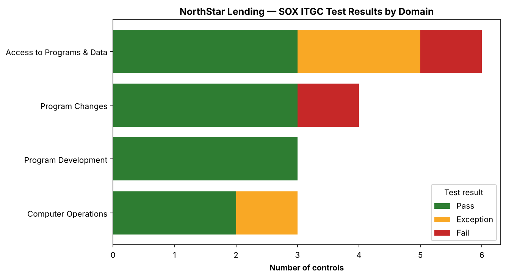

# SOX IT General Controls (ITGC) Assessment — Fintech

A **SOX IT General Controls assessment** for a fictional fintech preparing for IPO:
a 16-control ITGC matrix across the four standard domains, tested and classified by
deficiency severity, with a Python script that summarizes results and renders a status
chart, and an audit-style findings report.

> **Portfolio / lab project.** *NorthStar Lending, Inc.* is fictional. This is the
> finance-crossover piece of a three-project GRC portfolio — it sits on the seam
> between IT audit and financial reporting. Companion to the
> [risk assessment](../risk-assessment-fintech) and
> [controls crosswalk](../grc-controls-crosswalk).

---

## What SOX ITGC is (and why it matters)

**SOX Section 404** requires public companies to assess their **Internal Control over
Financial Reporting (ICFR)**. Because financial statements are produced by IT systems,
**IT General Controls** — the controls over access, change, development, and operations
— are the foundation that lets auditors trust those systems. If ITGCs fail, the
automated controls and reports built on them can't be relied upon. Full primer:
[`docs/01-sox-itgc-overview.md`](docs/01-sox-itgc-overview.md).

## Results at a glance

16 controls tested across the four ITGC domains:

| Effective (Pass) | Exceptions | Failures | Overall |
|------------------|-----------|----------|---------|
| 11 (69%) | 2 | 2 | **Material Weakness** |

Deficiencies: **1 material weakness** (developer access to production — a
segregation-of-duties failure), **2 significant deficiencies** (access management),
**2 control deficiencies**.



## The four ITGC domains covered

| Domain | Assures |
|--------|---------|
| Access to Programs & Data | Only authorized users reach financial systems (incl. segregation of duties) |
| Program Changes | Changes are authorized, tested, and approved before production |
| Program Development | New systems are built and implemented with controls |
| Computer Operations | Systems run reliably; backups and incidents are managed |

## Deliverables

- [`SOX-ITGC-Report.docx`](SOX-ITGC-Report.docx): audit-style findings report (Word)
- [`SOX-ITGC-Assessment.xlsx`](SOX-ITGC-Assessment.xlsx): control testing workbook (Excel)

## Repository structure

```
sox-itgc-assessment/
├── README.md
├── docs/
│   ├── 01-sox-itgc-overview.md     ← SOX, ICFR, the 4 domains, deficiency severity, SoD
│   └── 03-findings-report.md       ← findings, severity, root cause, remediation
├── data/
│   └── itgc-controls.csv           ← 16-control ITGC matrix with test results (source of truth)
├── scripts/
│   ├── itgc_assessment.py          ← summarizes results, classifies, renders status chart
│   └── requirements.txt
└── outputs/
    ├── itgc-assessment-summary.md
    └── itgc-status-by-domain.png
```

## How to run

```bash
pip install -r scripts/requirements.txt
python3 scripts/itgc_assessment.py
```

Reads the control matrix, tallies test results, counts deficiencies by severity,
derives the overall ICFR conclusion (the worst severity present drives it), and
regenerates the summary and chart.

## What this project demonstrates

- **SOX / ICFR fluency** — Section 404, the four ITGC domains, and the control-to-
  financial-reporting link.
- **Deficiency classification** — Control Deficiency vs. Significant Deficiency vs.
  Material Weakness (PCAOB AS 2201).
- **Segregation of Duties** — identifying and rating an SoD failure (the material weakness).
- **Audit deliverables** — a control matrix and a findings report in the format an IT
  auditor produces.
- **Light Python automation** — turning a control matrix into a scored, visual result.

## Standards referenced

SOX Section 404 · PCAOB AS 2201 · COSO Internal Control — Integrated Framework
